# Assignment 5: CSRF Vulnerable Form and Token-Based Prevention

## Table of Contents

1. [Aim](#1-aim)
2. [Introduction to CSRF](#2-introduction-to-csrf)
3. [Environment and Tools](#3-environment-and-tools)
4. [Project Structure](#4-project-structure)
5. [Part A: Vulnerable Implementation](#5-part-a-vulnerable-implementation)
6. [Part B: Attack Demonstration](#6-part-b-attack-demonstration)
7. [Part C: Prevention Using CSRF Tokens](#7-part-c-prevention-using-csrf-tokens)
8. [Part D: Testing the Fix](#8-part-d-testing-the-fix)
9. [Results and Comparison](#9-results-and-comparison)
10. [Additional Defenses and Limitations](#10-additional-defenses-and-limitations)
11. [Conclusion](#11-conclusion)
12. [References](#12-references)

---

## 1. Aim

The aim of this assignment was to create a web form that was vulnerable to Cross-Site Request Forgery (CSRF), show a working attack on it, and then stop the attack by adding CSRF tokens.

**Objectives**

- A simple banking application was built with a money-transfer form that had no CSRF protection.
- A separate attacker website was created to send a fake transfer on behalf of a logged-in user.
- A secret CSRF token was added to the form and checked on the server.
- Tests were done to confirm that normal use still worked and the fake request was rejected.

---

## 2. Introduction to CSRF

Cross-Site Request Forgery (CSRF) is an attack that tricks a logged-in user's browser into sending a request that the user did not intend to send. The website cannot tell the difference between the fake request and a real one. This happens because the browser automatically adds the user's session cookie to every request sent to that website, no matter which page started the request.

### 2.1 Conditions needed for a CSRF attack

A CSRF attack is possible when all three of these are true:

1. **There is a useful action**, such as transferring money or changing an email address.
2. **The website uses cookies for login**, so the browser adds the login information by itself.
3. **The request has no secret value**, so the attacker can prepare the whole request in advance.

### 2.2 How the attack works

1. The victim (Alice) logged in to the bank, and her browser stored the session cookie.
2. Alice then opened a malicious page in another tab.
3. The page had a hidden form that submitted to the bank.
4. The browser sent the request together with Alice's cookie.
5. The bank saw a valid session and completed the transfer.

The attacker never sees the cookie. The attacker only needs the victim's browser to send the request.

### 2.3 How CSRF tokens stop the attack

The server creates a secret random value for each session and places it inside its own forms. Every request that changes data must send this value back. A malicious website cannot read the value, because the browser's same-origin policy does not let one website read the pages of another. Because of this, the attacker cannot build a valid request.

---

## 3. Environment and Tools

| Item | Details |
|---|---|
| Operating system | Windows 11 |
| Language | Python |
| Framework | Flask |
| Browser |
| Bank application | http://localhost:5000 |
| Attacker website | http://localhost:5001 |
| Test accounts | alice / password123 (balance $5,000), bob / bobpass (balance $1,000) |

Alice was used as the victim, and Bob was used as the attacker's account.

### 3.1 Running the servers

Two servers were started in two separate terminals. The first ran the bank application and the second ran the attacker website.

```bash
# Terminal 1: bank application
cd csrf-lab
pip install -r requirements.txt
python app.py

# Terminal 2: attacker website
cd csrf-lab/attacker
python -m http.server 5001
```

**Figure 1: Both servers running in the terminals**

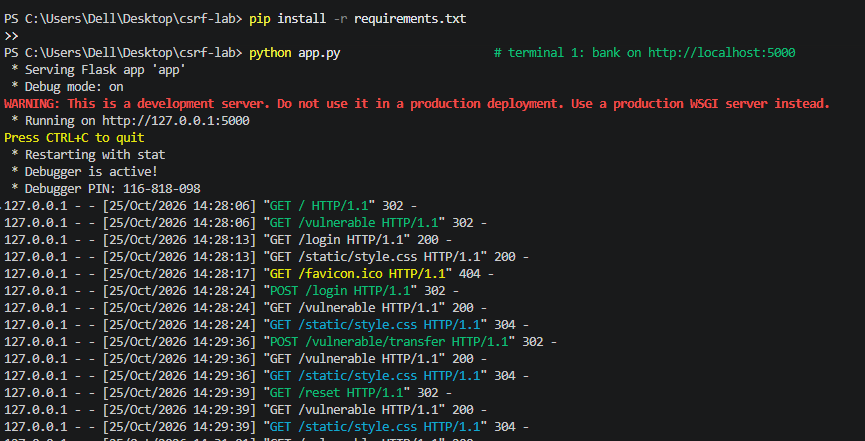

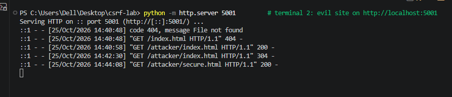

---

## 4. Project Structure

The project was organised as shown below.

```
csrf-lab/
  app.py               Flask server: vulnerable and secure routes, token logic
  requirements.txt     Flask
  templates/
    base.html          shared page layout
    login.html         sign-in page
    dashboard.html     transfer page (used by both versions)
    blocked.html       page shown when the token check fails
  static/style.css     styling (red = vulnerable, green = protected)
  attacker/
    index.html         attack page targeting the vulnerable form
    secure.html        same attack targeting the protected form
```

Both versions used the same template. The only difference in the form was the hidden token field, so the comparison was fair.

---

## 5. Part A: Vulnerable Implementation

### 5.1 Login

Users signed in with a username and password. After a successful login, the server saved the username in a signed session cookie.

**Figure 2: Login page**

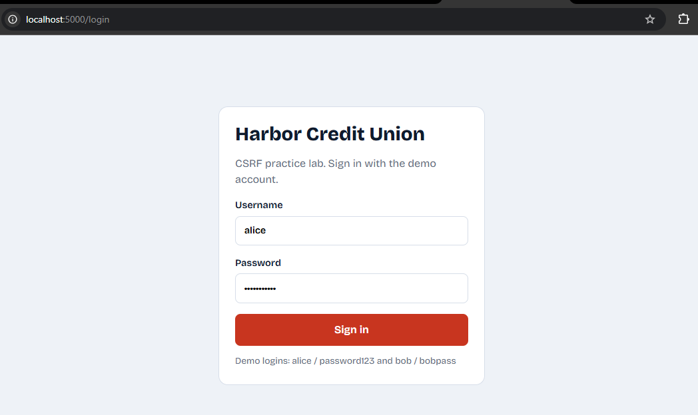

### 5.2 Vulnerable route

The vulnerable route handled the money transfer. It was written like this:

```python
@app.route('/vulnerable/transfer', methods=['POST'])
def vulnerable_transfer():
    if 'user' not in session:
        return redirect(url_for('login'))
    return transfer('vulnerable')
```

The only check was whether a session existed. Nothing proved that the request came from the bank's own form.

### 5.3 Vulnerable form

The form had no token:

```html
<form method="post" action="/vulnerable/transfer">
  <select name="to"> ... </select>
  <input name="amount" type="number">
  <button>Send money</button>
</form>
```

Both fields (`to` and `amount`) were easy to guess, so an attacker could copy the form on any website.

### 5.4 Why it was vulnerable

- It depended on a session cookie, which the browser sends automatically.
- The action changed data (it moved money).
- The request had no secret value, so it could be forged.

### 5.5 State before the attack

Before the attack, Alice was logged in and her balance was $5,000.

**Figure 3: Vulnerable page before the attack (Alice's balance was $5,000)**

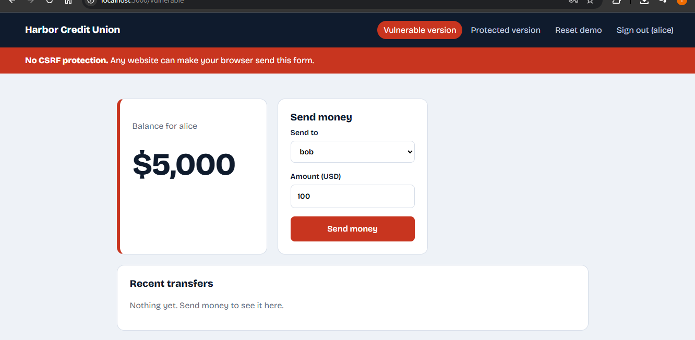

**Figure 4: Code of the vulnerable route and form (no token)**

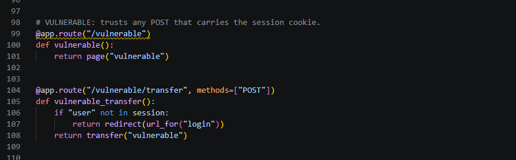

---

## 6. Part B: Attack Demonstration

### 6.1 The attacker page

The attacker page looked like a prize page. It contained a hidden form that pointed to the bank and submitted itself automatically after a short delay.

```html
<form id="csrf" action="http://localhost:5000/vulnerable/transfer"
      method="POST" hidden>
  <input name="to" value="bob">
  <input name="amount" value="2500">
</form>
<script>
  setTimeout(() => document.getElementById("csrf").submit(), 1500);
</script>
```

### 6.2 Procedure

1. Alice was kept signed in to the bank in the browser.
2. In the same browser, http://localhost:5001/index.html was opened in a new tab.
3. The page was left open for about two seconds while it submitted the hidden form.
4. The page http://localhost:5000/vulnerable was opened again to check the balance.

**Figure 5: Attacker page**

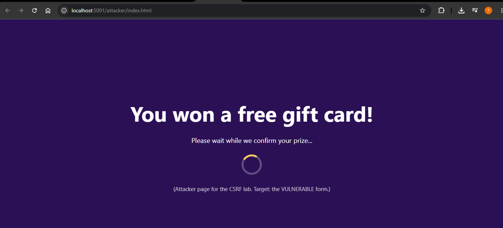

### 6.3 Result

Alice's balance dropped by $2,500, and the transfer list showed "alice to bob $2,500". Alice did not click anything on the bank's website. The attack was successful.

**Figure 6: Vulnerable page after the attack (Alice's balance was $2,500)**

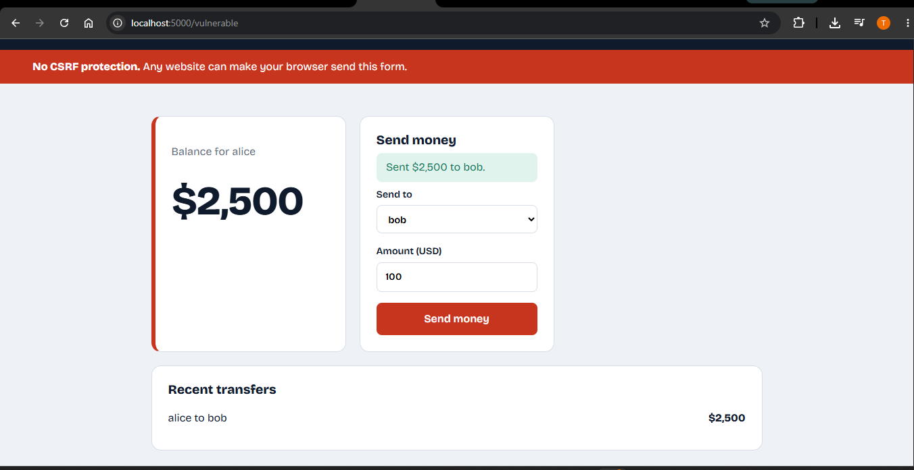

### 6.4 Why the attack worked

The browser added Alice's session cookie to the request that came from the attacker's page. The server saw a valid session and had no way to tell the request apart from a real one, so it completed the transfer.

---

## 7. Part C: Prevention Using CSRF Tokens

The vulnerability was fixed in four steps.

### 7.1 Step 1: Generate one token per session

A random token was created once for each session and saved in the session.

```python
import secrets, hmac

def get_csrf_token():
    if 'csrf_token' not in session:
        session['csrf_token'] = secrets.token_hex(32)
    return session['csrf_token']

app.jinja_env.globals['csrf_token'] = get_csrf_token
```

The function `secrets.token_hex(32)` produced 256 bits of secure random data. The last line made `csrf_token()` usable inside the templates.

### 7.2 Step 2: Put the token in the form

The token was added to the protected form as a hidden field.

```html
<form method="post" action="/secure/transfer">
  <input type="hidden" name="csrf_token" value="{{ csrf_token() }}">
  ...
</form>
```

### 7.3 Step 3: Check the token on the server

The server compared the token sent with the form to the token saved in the session. If they did not match, the request was stopped.

```python
def verify_csrf():
    sent = request.form.get('csrf_token', '')
    expected = session.get('csrf_token', '')
    if not expected or not hmac.compare_digest(sent, expected):
        abort(403)

@app.route('/secure/transfer', methods=['POST'])
def secure_transfer():
    if 'user' not in session:
        return redirect(url_for('login'))
    verify_csrf()
    return transfer('secure')
```

### 7.4 Step 4: Show a clear error

When the check failed, the server showed a "Request blocked" page with HTTP status 403.

```python
@app.errorhandler(403)
def forbidden(_):
    return render_template('blocked.html'), 403
```

### 7.5 Design decisions

| Decision | Reason |
|---|---|
| Random 256-bit token | An attacker cannot guess it |
| One token per session | A token from one user is useless for another user |
| `hmac.compare_digest` | The comparison takes the same time every time, which avoids timing attacks |
| Check on every POST that changes data | One unprotected route is enough for an attacker |
| Token in the form body, not in a cookie | Cookies are what the attacker's request already carries |
| POST used for actions that change data | GET requests can be triggered by images and links |

**Figure 7: Code that generates, embeds and verifies the token**

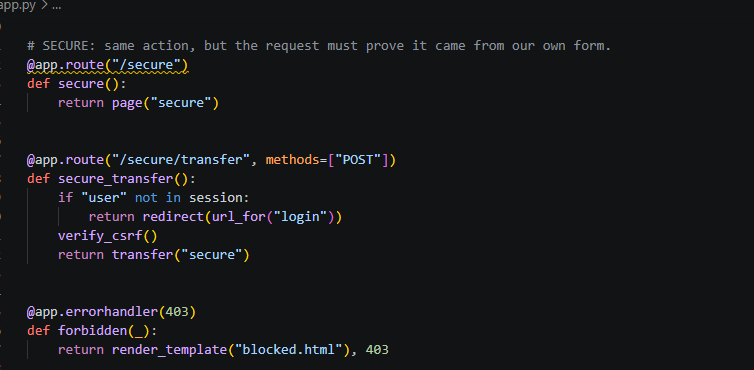

---

## 8. Part D: Testing the Fix

### 8.1 Test 1: Normal use

The demo was reset, the green **Protected version** was opened, and money was sent to Bob using the form.

The transfer was successful and Alice's balance was reduced by the amount sent. This showed that the form worked normally because it carried a valid token.

**Figure 8: Successful normal transfer on the protected version**

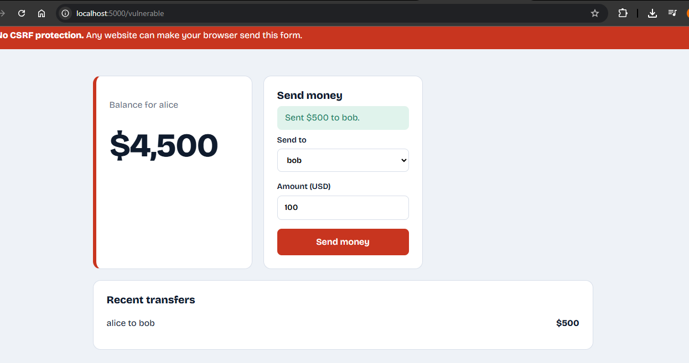

The hidden token field was then checked in the browser developer tools. It was visible in the form as a hidden input named `csrf_token` with a long random value.

**Figure 9: The hidden token field in the browser developer tools**

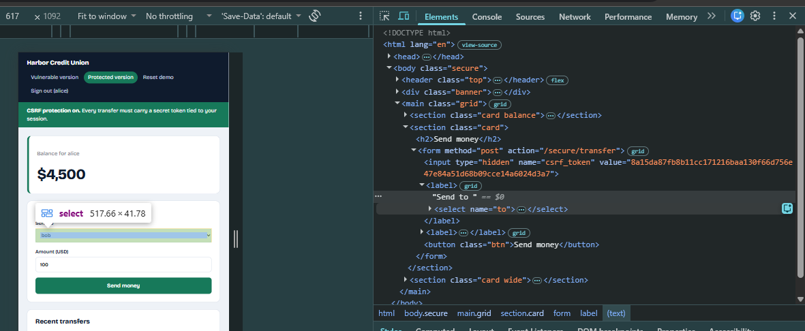

### 8.2 Test 2: The attack was blocked

In the same browser, http://localhost:5001/secure.html was opened. This page sent a request to `/secure/transfer` without a token.

The server rejected the request and showed the "Request blocked" page (HTTP 403). Alice's balance did not change.

**Figure 10: Request blocked page**

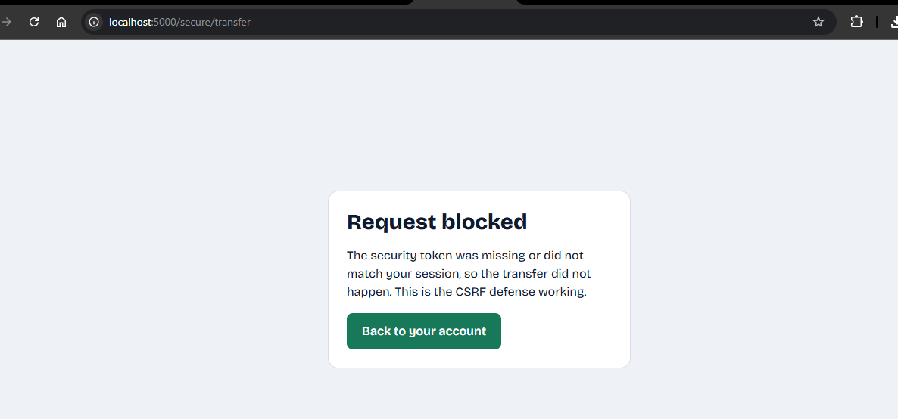

**Figure 11: Balance unchanged after the blocked attack**

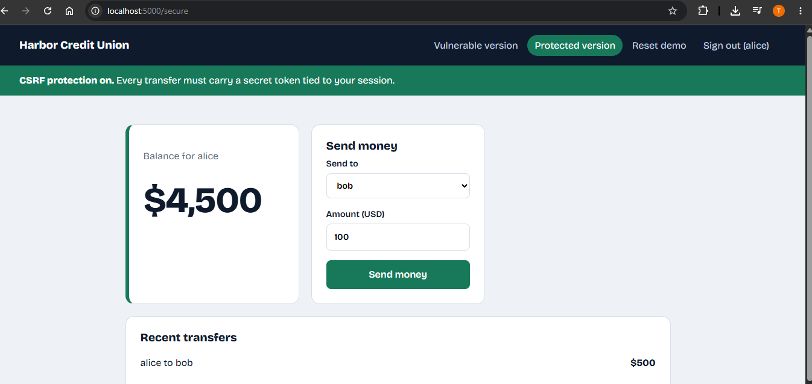

### 8.3 Test 3: Token removed

On the protected page, the hidden `csrf_token` input was deleted in the developer tools, and then **Send money** was clicked.

The request was blocked. This proved that the server really checked the token and did not just trust the form.

**Figure 12: Blocked after deleting the token field**

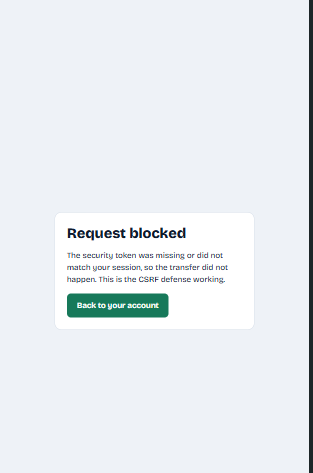

---

## 9. Results and Comparison

| Feature | Vulnerable version | Protected version |
|---|---|---|
| Hidden token in the form | No | Yes (random, per session) |
| Server checked the token | No | Yes (constant-time comparison) |
| Forged cross-site POST | Succeeded and money moved | Failed with HTTP 403 |
| Genuine user submitting the form | Worked | Worked |
| What the attacker needed | Only the form field names | The victim's secret token, which could not be read |

The attack that moved $2,500 from Alice to Bob on the vulnerable form was fully stopped on the protected form. Normal users did not notice any change.

---

## 10. Additional Defenses and Limitations

### 10.1 Other defenses

CSRF tokens are the main defense, but other measures can be used together with them:

- **SameSite cookies (`Lax` or `Strict`)**: the browser does not send the cookie on cross-site requests. This lab set `SESSION_COOKIE_SAMESITE='Lax'`.
- **Origin or Referer checks**: the server rejects requests whose `Origin` header is not its own website.
- **Double-submit cookie**: the token is sent both as a cookie and in the request body, and the server compares them. This helps when the server does not store session data.
- **Short-lived or per-request tokens** for very sensitive actions.
- **Re-login or confirmation** for important actions such as changing a password or making a payment.
- **Framework support**: Flask-WTF `CSRFProtect`, Django ``, Laravel `@csrf` and Spring Security. Real projects should use these instead of custom code.

### 10.2 Limitations and notes

- Ports on `localhost` count as the **same site**. Because of this, SameSite cookies did not stop the demo attack in this lab. On separate real domains, `SameSite=Lax` would already block this kind of cross-site POST. Tokens are still recommended as an extra layer, because older browsers, subdomain attacks and wrong cookie settings can still cause problems.
- CSRF tokens do not protect against **XSS**, because a script running on the page can read the token.
- The login form itself (login CSRF) was outside the scope of this lab.
- The "Reset demo" link was added only for convenience and was intentionally left unprotected.
- This project was made for learning only. The vulnerable version must not be deployed, and CSRF should only be tested on systems that you own or have written permission to test.

---

## 11. Conclusion

The vulnerable form accepted any POST request that carried a valid session cookie. Because of this, a hidden form on a malicious website was enough to move $2,500 out of the victim's account.

After a random per-session token was added to the form and checked on the server with a constant-time comparison, the same fake request was rejected with HTTP 403. At the same time, real transfers continued to work normally.

This showed that a CSRF token proves that a request came from the application's own form. When used together with SameSite cookies, Origin checks and framework protection, tokens give strong, layered protection against CSRF attacks.

---

## 12. References

1. OWASP Foundation, *Cross-Site Request Forgery Prevention Cheat Sheet*, https://cheatsheetseries.owasp.org/cheatsheets/Cross-Site_Request_Forgery_Prevention_Cheat_Sheet.html
2. OWASP Foundation, *Cross Site Request Forgery (CSRF)*, https://owasp.org/www-community/attacks/csrf
3. Flask Documentation, https://flask.palletsprojects.com/
4. Python Documentation, `secrets` and `hmac` modules, https://docs.python.org/3/
5. MDN Web Docs, *SameSite cookies*, https://developer.mozilla.org/en-US/docs/Web/HTTP/Cookies